<p align="center">
  
</p>

<h1 align="center">Khadeja · خديچة</h1>

<p align="center">
  A private AI chat assistant that runs <b>entirely on your phone</b>.<br/>
  Powered by Google's <b>Gemma 4 E2B</b> through LiteRT-LM — no server, no account. Chats never leave the device; only tools like weather go online.
</p>

<p align="center">
  
  
  
  
  
</p>

<p align="center">
  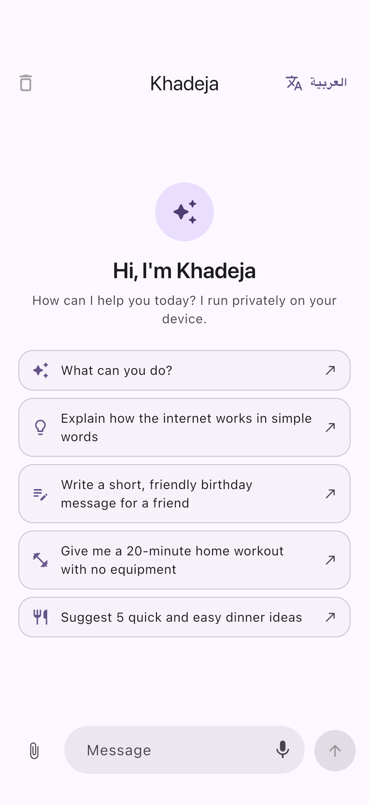
  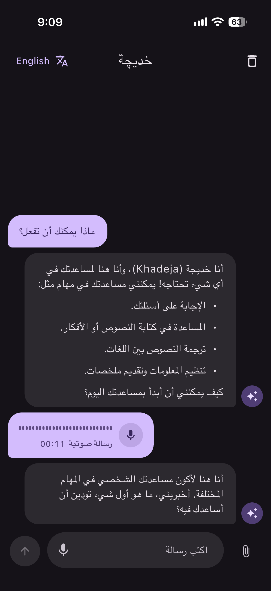
  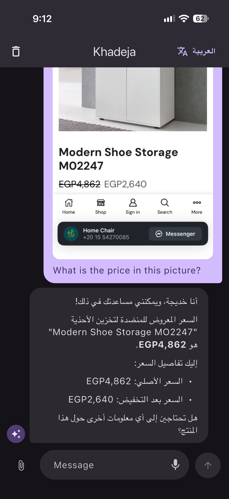
</p>

---

## Table of contents

- [What it does](#what-it-does)
- [Screenshots](#screenshots)
- [Features](#features)
- [How it works](#how-it-works)
- [Project structure](#project-structure)
- [Tech stack](#tech-stack)
- [Getting started](#getting-started)
- [Platform setup](#platform-setup)
- [Configuration](#configuration)
- [Testing](#testing)
- [Known limitations](#known-limitations)
- [Roadmap](#roadmap)
- [Acknowledgements](#acknowledgements)

---

## What it does

Khadeja is a Flutter chat app for Android and iOS. On first launch it downloads the
**Gemma 4 E2B (instruction-tuned)** model once, then every conversation runs **locally on the
device** with [`flutter_edge_ai`](https://pub.dev/packages/flutter_edge_ai) and the
LiteRT-LM engine. After the download, chatting works **fully offline**. She can also call
**tools**: ask about the weather and she looks it up (this one needs internet), ask the time,
or ask her to switch the app's language or to dark mode.

You can talk to her in **English or Arabic**, by text, with a **photo**, or with a
**voice message**, and she answers with streamed, markdown-formatted replies.

## Screenshots

| First-run download | Empty chat (RTL) | Streamed reply | Recording a voice message |
|:---:|:---:|:---:|:---:|
| 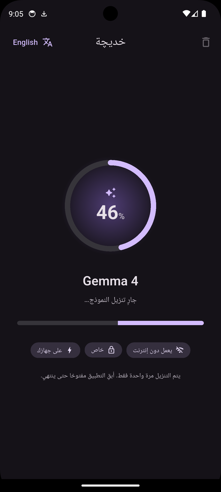 |  | 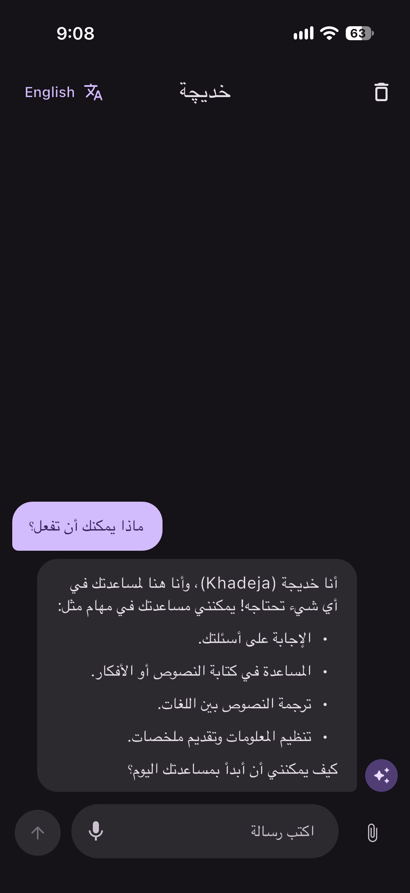 | 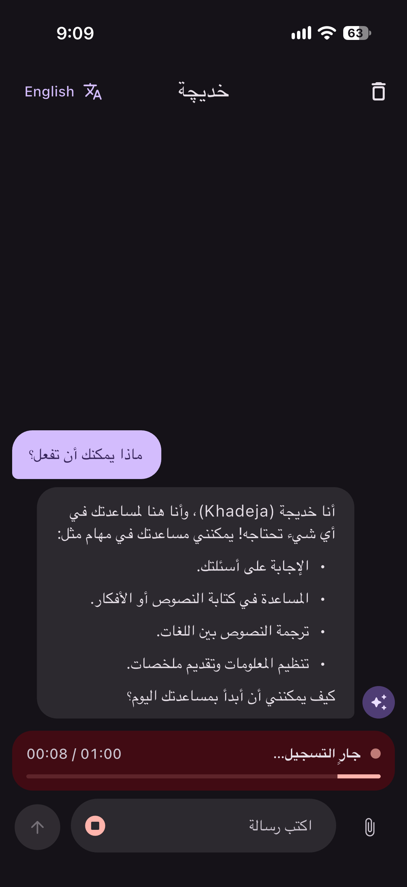 |

| Voice message attached | Reply to a voice message | Clear conversation |
|:---:|:---:|:---:|
| 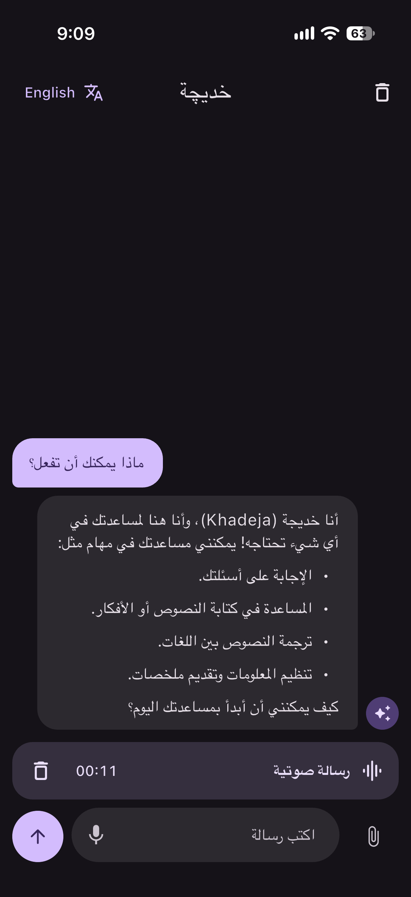 |  | 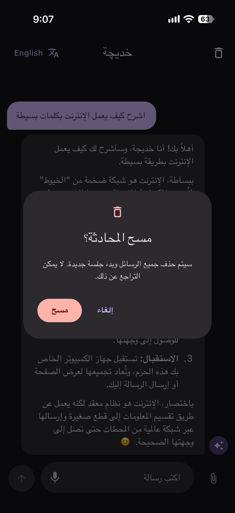 |

| Photo attached | Thinking… | Reply about the photo |
|:---:|:---:|:---:|
| 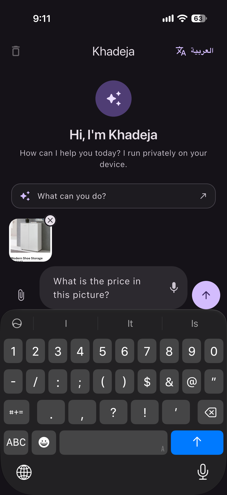 | 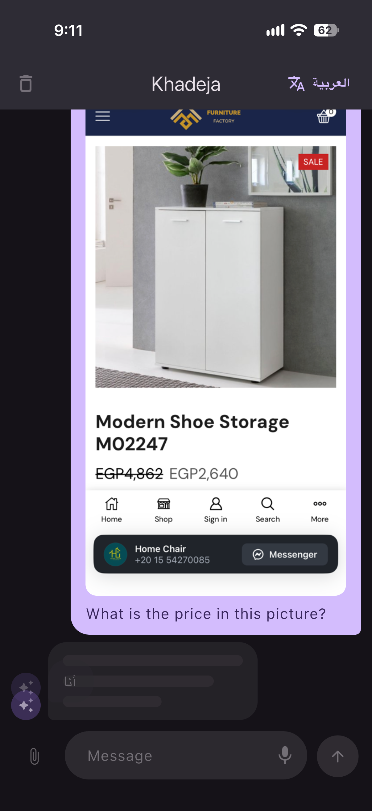 |  |

| App icon | Splash screen |
|:---:|:---:|
|  |  |

> Screenshots are from real devices running the model on-device: an iPhone, plus an Android phone for
> the download screen.

## Features

### 💬 Chat
- **Streaming replies** — tokens appear as the model writes them.
- **Skeleton loading** — a shimmering placeholder bubble until the first token arrives.
- **Markdown rendering** for replies: headings, lists, code blocks, quotes, tables, links.
- **Chat bubbles** — user on one side, assistant (with avatar) on the other; text is selectable.
- **Empty-chat screen** — Khadeja introduces herself with up to **5 tappable suggestions**
  (e.g. *“What can you do?”*) that send immediately.
- **Clear conversation** with a **confirmation dialog**; starts a fresh model session.
- Input is locked while a reply is being generated.

### 🖼️ Images & 🎙️ voice
- **Attach a photo** from the **camera** or **gallery**; preview thumbnail with full-screen,
  pinch-to-zoom view and a remove button.
- **Record a voice message** (16 kHz mono WAV, up to **60 s**) with a live preview: pulsing
  indicator, elapsed time vs. limit, progress bar, and a warning in the last 10 seconds.
- Recorded clips show in the bubble as a **voice-message row** with a **waveform drawn from the
  actual audio** and its duration.
- Images and audio are sent to Gemma 4's multimodal encoders together with (or without) text.

### 🌍 English & Arabic
- **Language switch** in the app bar; the choice is **saved** and restored on next launch
  (defaults to the device language).
- **Full right-to-left layout** in Arabic — bubbles, tails, shimmer direction and icons mirror.
- **Per-message text direction** — an Arabic message reads RTL even in the English UI, and
  vice versa.
- **Localized launcher name** — *خديچة* on Arabic devices, *Khadeja* elsewhere.

### 📋 Copy and share
- **Copy** and **Share** buttons under every message. Share opens the phone's share sheet
  (WhatsApp, Telegram, …). Khadeja's replies are shared without markdown symbols.

### 🤖 Assistant persona
- A short, structured **system prompt**: her name (*Khadeja / خديچة*), a warm and concise tone,
  how to use her tools, honesty about what she can't know, and safety rules. In Arabic she speaks about
  herself with feminine grammar.
- Context window set to **4096 tokens**, replies capped at **1024 tokens**.

### 🛠️ Tools (function calling)
- Gemma can ask the app to run a **tool**, then answers with the result.
- **`get_weather`**: current weather for a city, from [Open-Meteo](https://open-meteo.com)
  (free, no API key). Only the city name is sent. A weather card appears above her reply,
  in English or Arabic.
- **`get_local_weather`**: the weather where you are, when you ask without naming a city.
  Location permission is asked **the first time you ask**, never at startup. Only lat/lng go
  to Open-Meteo; the place name comes from the phone's own geocoder. If the location isn't
  available (denied, off, or slow), she **asks which city you're in** and looks that up.
- **`get_current_time`**: the time, date and day of the week from the phone's clock, in its
  time zone. Works offline.
- **`change_language`**: switches the app to English or Arabic ("switch to Arabic"), the same
  as the app bar button.
- **`change_theme`**: light, dark, or follow the phone ("dark mode please"). The language and
  theme are saved and kept after a restart.
- Errors (no internet, unknown city) come back to Gemma, which explains them in the chat.

### 📥 First-run model download
- One-time download screen with an animated **progress ring**, status text and a progress bar.

### 🎨 Branding
- Original **keyhole + spark** app icon — *intelligence you keep under lock*.
  - Android adaptive icon with a **themed (monochrome) layer** for Android 13+.
  - iOS icon set without transparency (App Store-ready).
- **Native splash screen** (Android 12+ splash API and legacy Android, iOS launch screen).
- Material 3 theme from a deep-purple seed; every widget takes its colours from the theme.

### 🔐 Permissions
- **Camera** and **microphone** permissions requested at runtime with
  [`permission_handler`](https://pub.dev/packages/permission_handler); photo-library access is
  declared for both platforms, and the gallery itself opens through the system photo picker.

## How it works

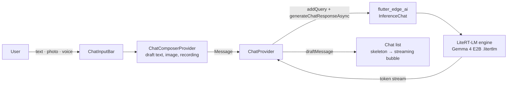

1. **Startup** — `main()` initializes `flutter_edge_ai` with the LiteRT-LM engine and loads the
   saved language before the first frame (the native splash covers this).
2. **Model install** — `ChatProvider.init()` downloads the `.litertlm` file from Hugging Face
   (once), loads it with image and audio support, and opens a chat session with the system prompt.
3. **Sending** — the composer builds a `Message` (text + optional image/audio bytes) and
   `ChatProvider.send()` adds it to the session.
4. **Streaming** — tokens from `generateChatResponseAsync()` are appended to a `StringBuffer`;
   only the bottom “draft” bubble rebuilds per token. When the stream ends, the draft becomes a
   normal message in the history.

State management uses [`provider`](https://pub.dev/packages/provider) with `ChangeNotifier`s.

## Project structure

```text
lib/
├── main.dart                         # App entry: engine init, DI, locale, theme, providers
├── core/
│   ├── localization/                 # All UI text (English + Arabic)
│   ├── network/
│   │   ├── error/                    # Failure types, ErrorHandler, NotFoundException
│   │   └── web_service/              # NetworkHelper + DioImpl, API endpoints
│   ├── services/                     # get_it + injectable; ToolsInjection registers tools
│   ├── tools/                        # The toolbox: AppTool, ToolRegistry, ToolResult, cards
│   ├── use_cases/use_cases.dart      # UseCase<T, Params> → Either<Failure, T>
│   └── utils/                        # Constants + system prompt, text direction, WAV info
└── features/
    ├── app_settings/                 # Language + theme, saved; change_language, change_theme
    │   ├── data/                     # shared_preferences data source, repository
    │   ├── domain/                   # AppSettings, enums, repository, use cases
    │   ├── presentation/provider/    # AppSettingsProvider (feeds MaterialApp)
    │   └── tool/                     # change_language, change_theme
    ├── chat/
    │   ├── data/                     # ChatDataSource (only file using flutter_edge_ai), tool loop
    │   ├── domain/                   # ChatEvent, ChatEntry, repository, use cases
    │   └── presentation/             # Screen, providers, bubbles, input bar, tool cards
    ├── time/                         # get_current_time: use case + tool, no data layer
    ├── location/                     # Current lat/lng + place name (geolocator, geocoding)
    └── weather/                      # One tool feature: get_weather + get_local_weather
        ├── data/                     # Open-Meteo data source, models, repository
        ├── domain/                   # Params, repository, GetCurrentWeatherUseCase
        ├── tool/                     # get_weather, get_local_weather: schema + args → use case
        └── presentation/widgets/weather_card.dart

assets/
├── icon/      # App icon sources (SVG) and 1024 px PNGs
└── splash/    # Splash screen images (legacy + Android 12)

test/                                 # Mirrors lib/; fixtures/ holds saved API responses
```

The full design is in [`docs/ai-tools-architecture-design/architecture-design.md`](docs/ai-tools-architecture-design/architecture-design.md).

### Adding a tool

1. Create `lib/features/<tool>/` with `data`, `domain`, `tool/<name>_tool.dart` (extends
   `AppTool`) and, if it needs a card, `presentation/widgets/`.
2. Add the tool to `ToolsInjection` in `lib/core/services/injection.dart` (and its card to
   `ToolResultViews`), then run `dart run build_runner build --delete-conflicting-outputs`.
3. List it in the Tools section above, and say whether it goes online.

## Tech stack

| Area | Package |
|---|---|
| On-device inference | [`flutter_edge_ai`](https://pub.dev/packages/flutter_edge_ai), [`flutter_edge_ai_litertlm`](https://pub.dev/packages/flutter_edge_ai_litertlm) |
| Model | [`litert-community/gemma-4-E2B-it-litert-lm`](https://huggingface.co/litert-community/gemma-4-E2B-it-litert-lm) |
| UI | [`material_ui`](https://pub.dev/packages/material_ui), [`flutter_markdown_plus`](https://pub.dev/packages/flutter_markdown_plus) |
| State | [`provider`](https://pub.dev/packages/provider) |
| DI | [`get_it`](https://pub.dev/packages/get_it), [`injectable`](https://pub.dev/packages/injectable) |
| Network | [`dio`](https://pub.dev/packages/dio), [`pretty_dio_logger`](https://pub.dev/packages/pretty_dio_logger), [`dartz`](https://pub.dev/packages/dartz) |
| Weather API | [Open-Meteo](https://open-meteo.com) (no key) |
| Location | [`geolocator`](https://pub.dev/packages/geolocator), [`geocoding`](https://pub.dev/packages/geocoding) |
| Storage | [`shared_preferences`](https://pub.dev/packages/shared_preferences) |
| Sharing | [`share_plus`](https://pub.dev/packages/share_plus) |
| Media | [`image_picker`](https://pub.dev/packages/image_picker), [`record`](https://pub.dev/packages/record) |
| Permissions | [`permission_handler`](https://pub.dev/packages/permission_handler) |
| Branding (dev) | [`flutter_launcher_icons`](https://pub.dev/packages/flutter_launcher_icons), [`flutter_native_splash`](https://pub.dev/packages/flutter_native_splash) |

## Getting started

### Requirements

- **Flutter 3.50+** (Dart **3.14+**)
- **Xcode** for iOS, **JDK 17+** and the Android SDK for Android
- A device with an **arm64** CPU and a few GB of free storage for the model
  - Android **11+** (`minSdk 30`) · iOS **15+**

### Run

```bash
git clone https://github.com/thebeast1/personal_ai_assistant.git
cd personal_ai_assistant
flutter pub get
flutter run
```

On first launch the app downloads the Gemma 4 E2B model (a few GB), so use Wi-Fi. After that it
chatting works offline.

## Platform setup

Already configured in this repo — listed here for reference.

**Android** (`android/app/src/main/AndroidManifest.xml`, `build.gradle.kts`)
- `minSdk = 30` (required by LiteRT-LM).
- `INTERNET` for the model download and online tools (also in release builds).
- `ACCESS_COARSE_LOCATION` for `get_local_weather` (asked only when it runs).
- `CAMERA`, `RECORD_AUDIO`, and photo access (`READ_MEDIA_IMAGES`,
  `READ_MEDIA_VISUAL_USER_SELECTED`, `READ_EXTERNAL_STORAGE` up to API 32).
- GPU/NPU native-library entries merge in automatically from the plugin.

**iOS** (`ios/Runner/Info.plist`, `Runner.entitlements`)
- Deployment target **15.0**.
- `NSCameraUsageDescription`, `NSPhotoLibraryUsageDescription`, `NSMicrophoneUsageDescription`,
  `NSLocationWhenInUseUsageDescription`.
- Increased-memory and extended-virtual-addressing entitlements for the large model
  (needs a paid Apple developer account; remove them for free provisioning).
- Localized display name in `en.lproj` / `ar.lproj` `InfoPlist.strings`.

> **permission_handler + Swift Package Manager:** permissions are compiled in based on the
> `Info.plist` keys, and Xcode caches that result. After adding a new usage-description key,
> clear the caches so a request doesn't return `permanentlyDenied` without a prompt:
>
> ```bash
> flutter clean
> rm -rf ~/Library/Caches/org.swift.swiftpm/manifests ~/Library/Developer/Xcode/DerivedData
> ```

## Configuration

| What | Where |
|---|---|
| Model download URL | `AppConstants.gemmaURL` |
| Assistant name | `AppConstants.assistantNameEn` / `assistantNameAr` |
| System prompt | `AppConstants.systemInstruction` |
| Context window / reply length | `maxTokens` / `maxOutputTokens` in `ChatProvider` |
| UI text (EN/AR) | `lib/core/localization/app_strings.dart` |
| App icon | `assets/icon/` → `dart run flutter_launcher_icons` |
| Splash screen | `assets/splash/` → `dart run flutter_native_splash:create` |
| Launcher name | `android/.../res/values*/strings.xml`, `ios/Runner/*.lproj/InfoPlist.strings` |

## Testing

```bash
flutter analyze
flutter test
```

`test/core/wav_info_test.dart` checks WAV duration parsing, the generated waveform, and rejection
of non-WAV data.

`integration_test/screenshots_test.dart` drives the real app (with the real model) through the main
screens and saves screenshots to `docs/screenshots/` (it uses its own file names; the README images
were taken by hand on real devices). `flutter drive` uninstalls the
app when it finishes, so each run downloads the model (~2.6 GB) again first:

```bash
flutter drive -d <device-id> \
  --driver=test_driver/integration_test.dart \
  --target=integration_test/screenshots_test.dart \
  --dart-define=SAMPLE_PHOTO=/path/to/photo.png   # optional, for the attachment shot
```

## Known limitations

- **iOS Simulator runs the model on CPU only** — the GPU engine fails there and falls back to
  CPU, so replies are slow. The simulator also has no camera. Test on a real device.
- **arm64 only** — LiteRT-LM ships arm64 binaries; x86 Android emulators can't run the model.
- **Context fills up** in long chats (4096 tokens, images ≈ 140 tokens each). When it's full the
  message is rejected; clear the conversation to start a new session.
- **Voice messages can't be played back** in the app yet — the bubble shows the waveform and
  duration only.
- The model has **no web access**: only its tools (weather for now) go online, so it can't
  answer about current events.

## Roadmap

- [ ] Web search (RAG) for up-to-date answers
- [ ] Automatically start a new session when the context window is full
- [ ] Voice-message playback
- [ ] Save conversations between launches
- [ ] Stop-generation button
- [x] Dark theme (follows the system setting, or ask Khadeja for light or dark)
- [x] Function calling (tools): weather by city and for your location
- [x] Ask for your city when the location isn't available
- [x] Tools for the time, the app's language and light/dark mode

## Acknowledgements

- [Gemma](https://ai.google.dev/gemma) by Google DeepMind — Gemma 4 E2B weights are released under Apache-2.0.
- [LiteRT-LM](https://github.com/google-ai-edge/LiteRT-LM) and the
  [`flutter_edge_ai`](https://pub.dev/packages/flutter_edge_ai) packages for on-device inference.
